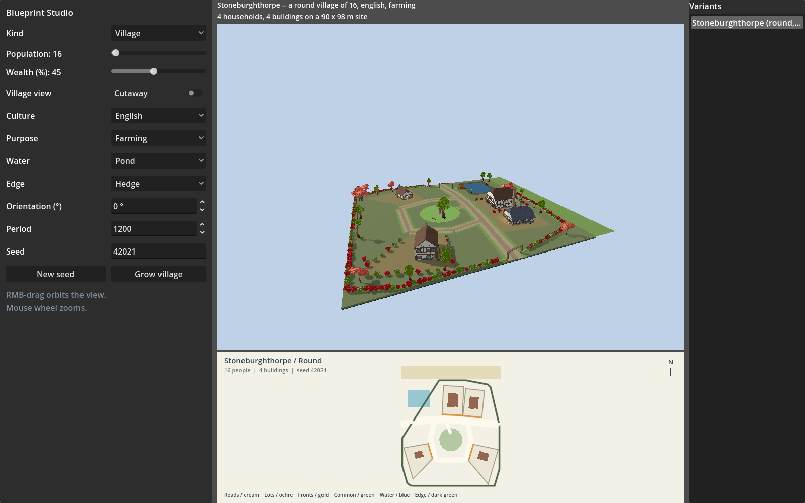
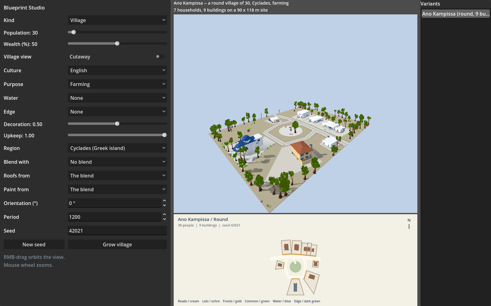

# Village Studio

Choose Village in the Studio to grow a seeded settlement. Population, culture,
purpose, wealth, water and edge controls come from `BrickWild.describe_kind()`;
the UI has no separate option tables. Set the controls and press **Grow village**.
**New seed** keeps the controls and grows another settlement.

The preview uses `VillageAssembler`, so it shows the same buildings, gardens and
street furniture as an instantiated village. The sheet beneath it draws the
actual plan's roads, lots, frontages, common, water and enclosure. Its enclosure
comes from `VillageEnclosurePlan`, the same geometry source as the builder.



The screenshot is seed 42021, population 16, English farming, wealth 45%, pond
and hedge. Reproduce it with a visible renderer:

```powershell
godot --path . --script res://tools/shoot_studio.gd -- village
```

The capture writes both `artifacts/renders/studio_village.png` and the tracked
documentation image above. `tests/studio_village_test.gd` checks that UI options
match the public descriptor, the seed control exists, water/edge survive request
JSON, zero wealth is valid, small defensive walls are refused, and the blueprint
retains the actual VillagePlan. The capture additionally exercises real generation
and assembled model assets. The three-column Studio uses an `HBoxContainer`;
`HSplitContainer` only lays out two children.

## Regional villages

Below Decoration and Upkeep are the regional controls
(`docs/VILLAGE_VERNACULAR.md`). Their lists come from
`BrickWild.describe_kind(&"village")["vernacular"]`, like every other control.

| Control | What it asks for |
|---|---|
| Region | None (the culture alone), or Provence, the Cyclades, the Norse north or Japan: house types by wealth, colours, roofs, church, plants, ground and names |
| Blend with | an optional second region; each house draws its type, walls, trim and roof from one or the other |
| *Region* share | how much of the village the second region gets |
| Coherence | 0, one hybrid people; 1, two peoples side by side, each house wholly one or the other |
| Roofs from | every roof from one region, whatever the houses are |
| Paint from | the walls and trim from one region: one people's paint on another's houses |

The blend controls appear once a region is chosen, and the share and coherence
appear once there is a second region. The request carries the result as
`vernacular`. The description line above the preview names the blend
("Japanese 50% + Norse 50%"). Culture still chooses what the dataset does not
say, such as the castle. Left at English, a region's own culture stands in.



Seed 42021, population 30, wealth 50%, Region Cyclades. Reproduce it, and a
Norse and Japanese blend in `artifacts/renders/studio_village_blend.png`, with
a visible renderer:

```powershell
godot --path . --script res://tools/shoot_studio.gd -- vernacular
```

`tests/studio_village_test.gd` checks the region pickers against the
descriptor. It checks that nothing is asked for until a region is chosen, that
one region is a plain blend, and that a blend with share, coherence and roofs
from a third region is a request the library takes and JSON keeps.
